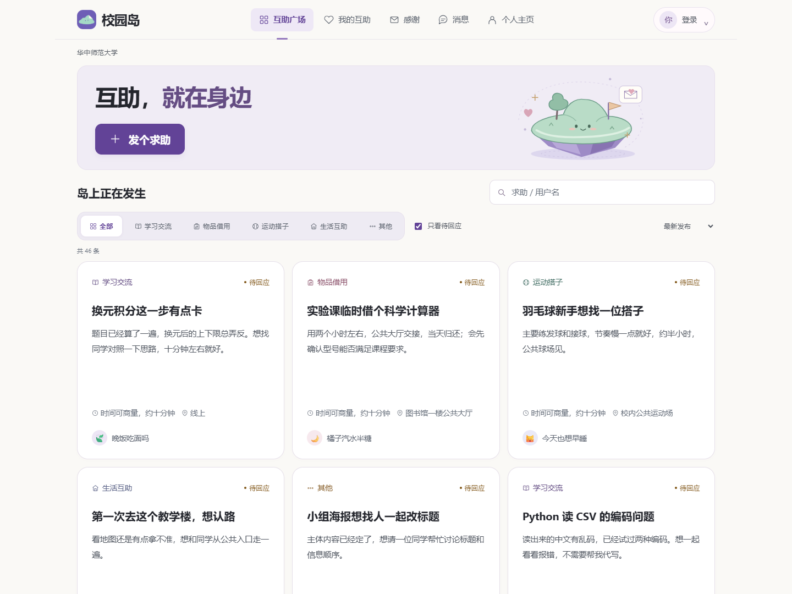
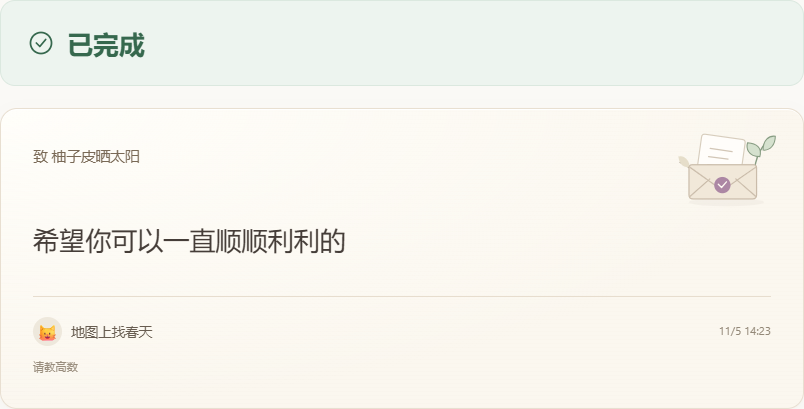

<div align="center">
  
  <h1>校园岛</h1>
  <p><strong>互助，就在身边。</strong></p>
  <p>让校园里的小求助，有人回应，也有结果。</p>
  <p><a href="https://xiaoyuandao73.asia">在线体验 →</a></p>
</div>

校园岛是面向同校同学的轻量互助平台。把群聊里容易被刷走的求助，变成可以发现、回应、沟通和确认完成的协作。



## 从一句求助，到一声谢谢

**发布求助 → 同学回应 → 选定帮助者 → 私信协作 → 双方确认 → 留下感谢**

学习交流、物品借用、运动搭子、生活互助，以及不便归类的「其他」。物品借用有独立的交付、归还和出借方确认流程。

## 核心设计

- **同校互助**：按学校隔离求助、搜索和会话，服务端检查访问权限。
- **邮箱即账号**：验证码登录，首次验证创建账号；支持账号切换、唯一用户名和自定义头像。
- **学校邮箱认证**：按官方后缀白名单验证邮箱归属；退出学校后可重选，认证随之重置。
- **协作有结果**：选定一位帮助者、记录状态、通知进展，完成后生成感谢卡。
- **沟通在站内**：文字与图片私信、未读提醒、图片放大；完成后的聊天保留为只读记录。
- **克制的界面**：深浅色模式、手机双列卡片、统一信息表单、轻量动效与纸笺感谢卡。



## 当前版本

| 能力 | 状态 |
| --- | --- |
| 账号、求助、私信、头像持久保存 | 已实现 |
| 求助与用户名搜索、分类、状态筛选、排序 | 已实现；电脑每页 6 条，手机每页 4 条 |
| 学校目录 | 1412 所本科高校，学校搜索每页最多 6 所 |
| 学校邮箱认证 | 31 所已核实开放；其余逐校核实，华师学生邮箱已实际收码验证 |
| 数据管理 | 独立授权后台：账号、求助、学校人数、来源分类与概览导出 |
| 模拟流程 | 共用模拟账号可免验证码进入；支持导入 100 个账号与 100 条求助样本 |

**体验方式**：使用自己的邮箱登录；或点击账号入口 →「我的账号」→「模拟账号」。双人演示请用两个独立浏览器会话，并选择同一学校的两个账号。

模拟样本不代表真人使用量。学校认证证明邮箱控制权，不等同于在读学籍。部分访客曾遇到托管层访问拦截，兼容性仍需完善。

## 本地运行

Node.js 24+，无需安装运行依赖。

```bash
git clone https://github.com/irishale63-jpg/campus-island.git
cd campus-island
npm start
```

打开 `http://localhost:3000`。Windows 也可双击「启动校园岛.cmd」。

- 本地数据在 `data/`；线上与本地数据相互独立。
- 邮件需配置 `RESEND_API_KEY`、`VERIFICATION_FROM`、`VERIFICATION_SECRET`；学校后缀由后台配置。未配置时不会发送验证码。
- `/admin` 使用独立管理口令；本地首次启动在 `data/admin-key.txt` 生成，线上通过 `ADMIN_KEY` 配置。

## 实现与验证

原生 HTML / CSS / JavaScript；Node.js 本地服务与云端共用业务规则。线上采用 Cloudflare Workers、D1 数据库和 R2 图片存储。

`npm test`：**35 项测试通过**，覆盖账号持久化、邮箱验证码、学校隔离、双人协作、借物归还、消息权限及并发选人。

当前是可运行的 MVP：云端采用带并发校验的状态快照，有明确容量上限；消息通过轮询更新。更大规模的存储、即时通信和稳定访问是后续方向。
