<div align="center">
  
  <h1>校园岛</h1>
  <p><strong>互助，就在身边。</strong></p>
  <p>面向校园生活的互助平台 · 一个学校，一个圈子</p>
  <p><a href="#一分钟看懂校园岛">观看演示</a> · <a href="https://xiaoyuandao73.asia">在线体验</a> · <a href="docs/product-guide.md">完整产品说明</a></p>
</div>

## 为什么做校园岛？

在图书馆急需借一个计算器，我们去哪里找人帮忙？

**问朋友，对方未必有；发到群里，消息可能很快被刷走；发校园墙或小红书，又不一定等得及。**

这些求助方式，在**可达性、可见性和时效性**上，都存在一定的局限。

校园岛提供集中的求助入口，让熟人圈之外的同学也能发现需求、参与帮助。双方可以私信沟通，并在交付、归还和完成时确认进度，让线上的协作状态与线下的实际行动保持一致。

## 一分钟看懂校园岛

[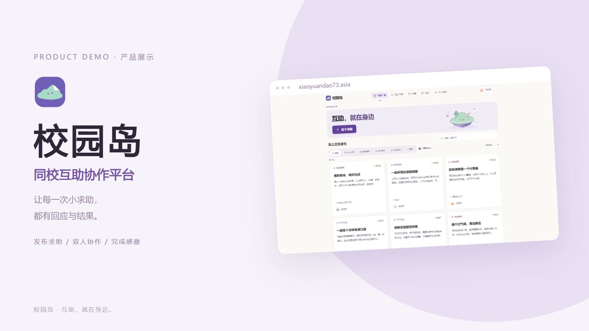](docs/media/campus-island-demo.mp4)

**[▶ 观看完整视频 · 约 55 秒](docs/media/campus-island-demo.mp4)**

从图书馆里的一次借物需求开始，看求助者和帮助者如何完成回应、沟通、线下交接、归还确认，以及最后的一封感谢信。

<!-- 如需在 GitHub README 内直接播放，在 GitHub 网页编辑器上传 docs/media/campus-island-demo.mp4，并用生成的视频附件地址替换上方封面与视频链接。 -->

## 三个设计重点

### 01 · 集中呈现需求

同校求助集中展示，每条需求都有独立页面，清楚呈现相关信息和回应，让同学在回应前了解具体情况，减少反复询问。

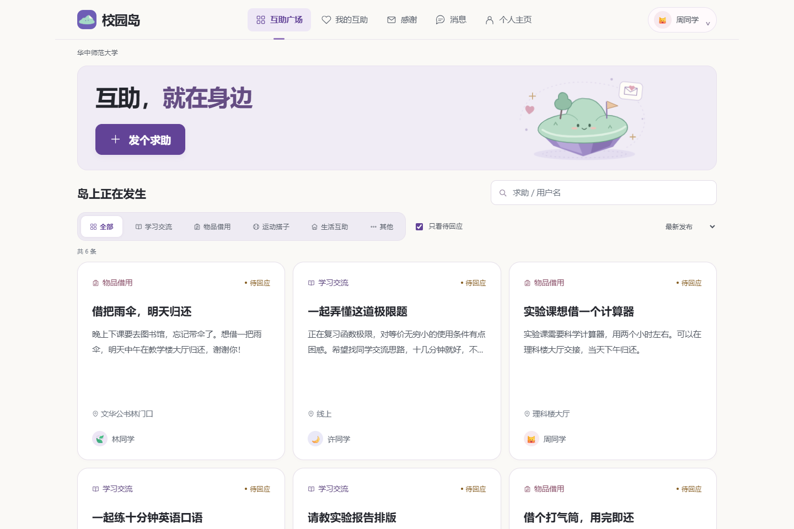

<details>
<summary>查看需求发布页面</summary>

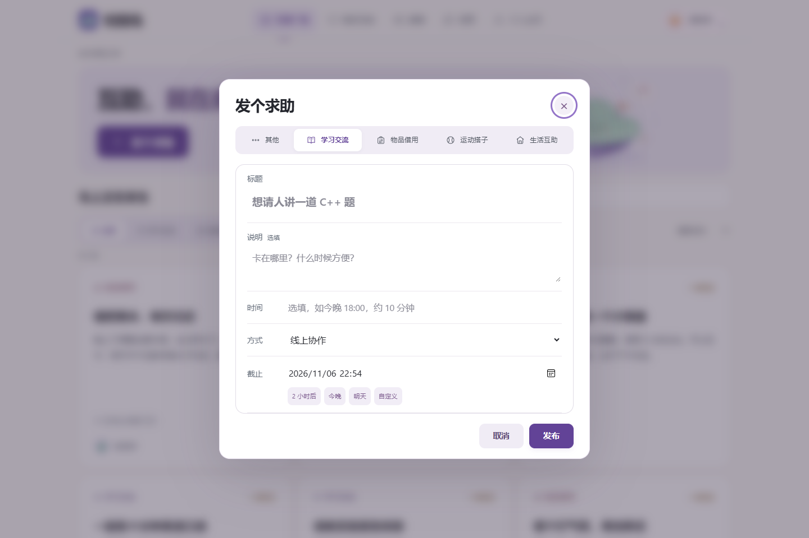

</details>

### 02 · 协作进度清楚可见

**发布求助 → 回应匹配 → 沟通交接 → 完成互助**

求助者选定帮助者，双方通过私信沟通安排。每个关键步骤有对应的状态与站内通知，让彼此知道当前进展和下一步操作。

借物场景中，交付和归还分别确认：

> 帮助者确认交付 → 求助者提交归还 → 帮助者确认收到 → 双方完成确认

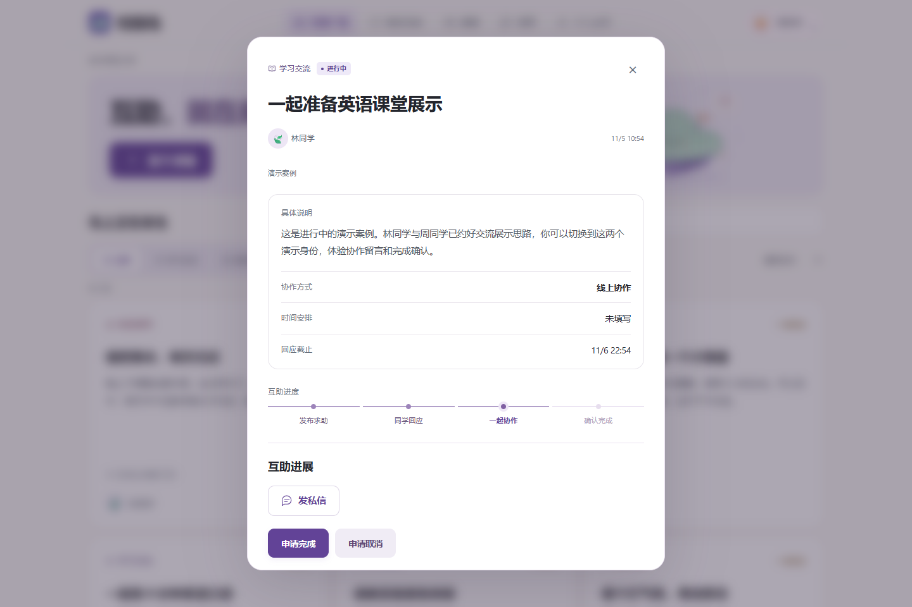

### 03 · 善意有迹可循

互助完成后，求助者可以送出感谢信。它既是对帮助者的回应，也为这次互助留下记录，让校园里的关怀被看见，让每一次善意都可以回顾。

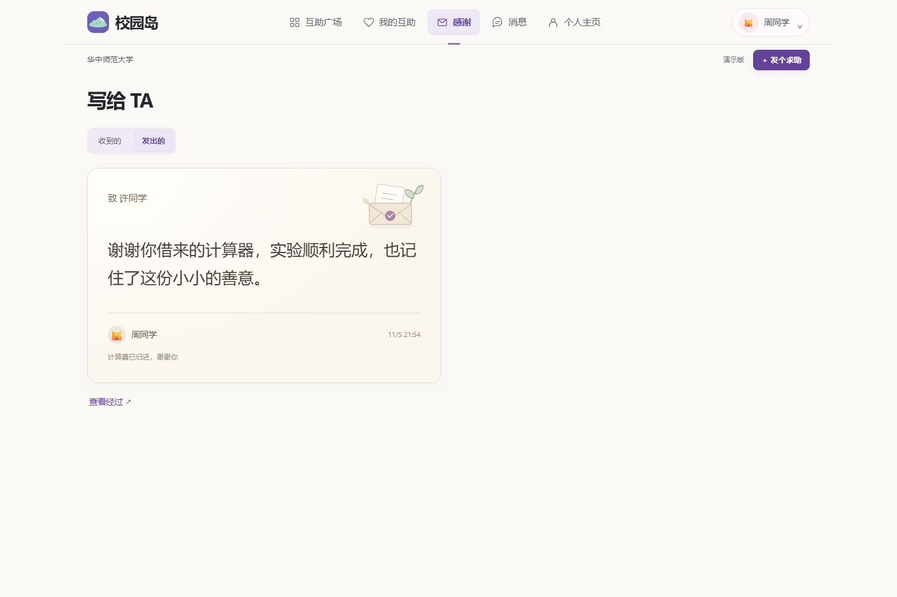

## 配套功能

### 1. 邮箱登录与学校互助圈

支持邮箱验证码登录，方便保存并找回自己的账号与互助记录。采用“一个学校、一个圈子”的模式，已收录千余所本科高校，支持学校搜索与选择；学校邮箱认证让同校同学的归属有据可查。

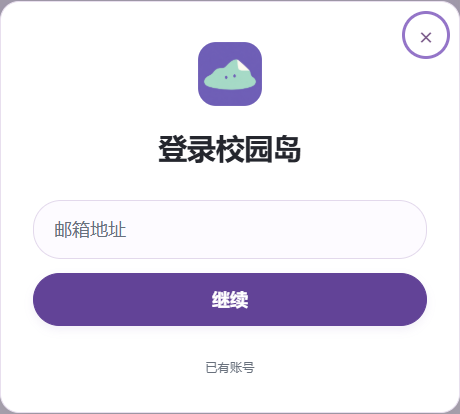

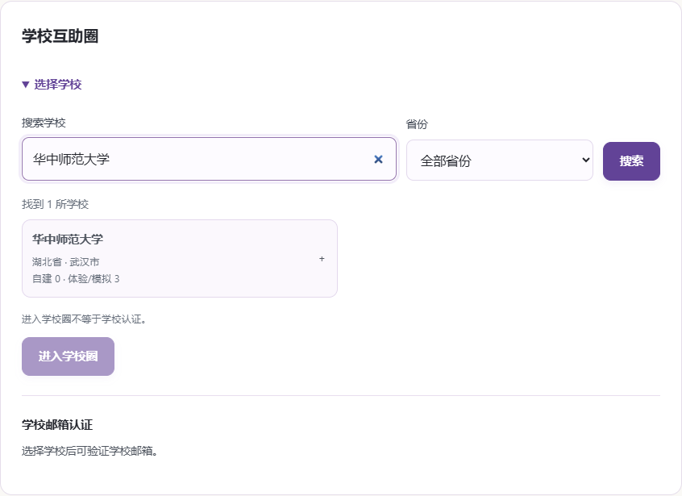

### 2. 需求分类、搜索与排序

按类别寻找需求，通过关键词搜索求助或用户名，并按发布时间或截止时间排序；也可以只查看等待回应的求助。


### 3. 图文聊天与个人主页

聊天支持文字与图片，方便双方沟通具体安排。个人主页可以展示专长和愿意提供的帮助，让同学在建立联系前相互了解。

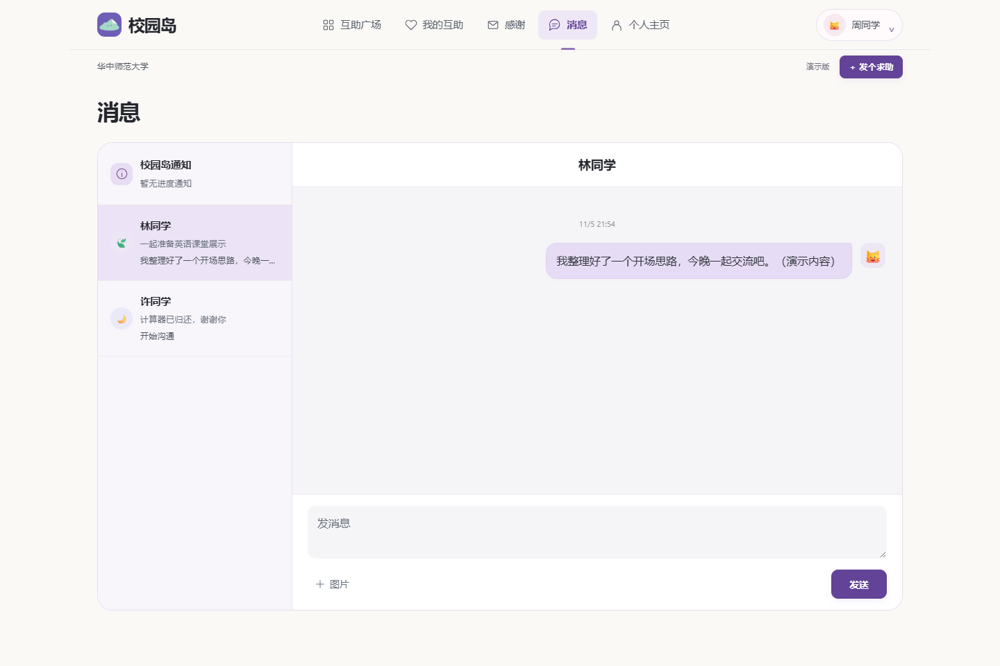

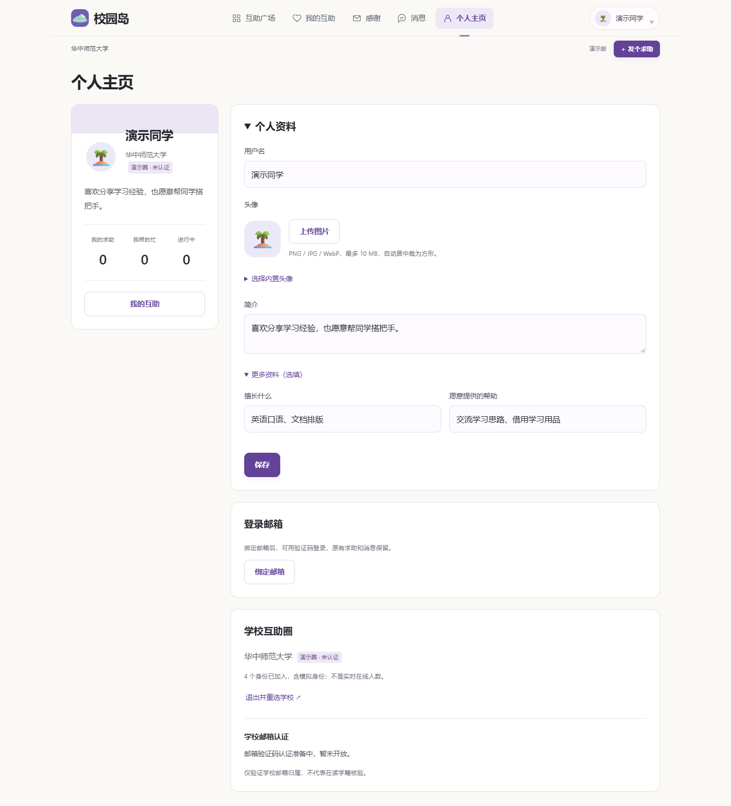

### 4. 手机与电脑适配

电脑端集中展示需求和协作信息；手机端调整卡片布局与导航，便于随时查看和操作。以下为实际手机尺寸下的页面截图。

<p>
  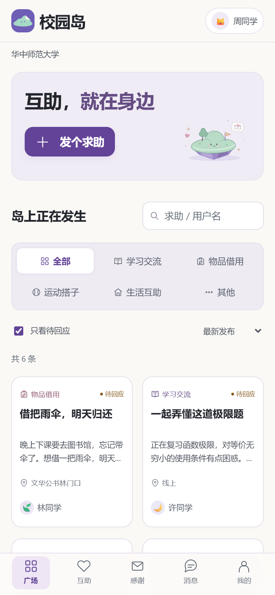
  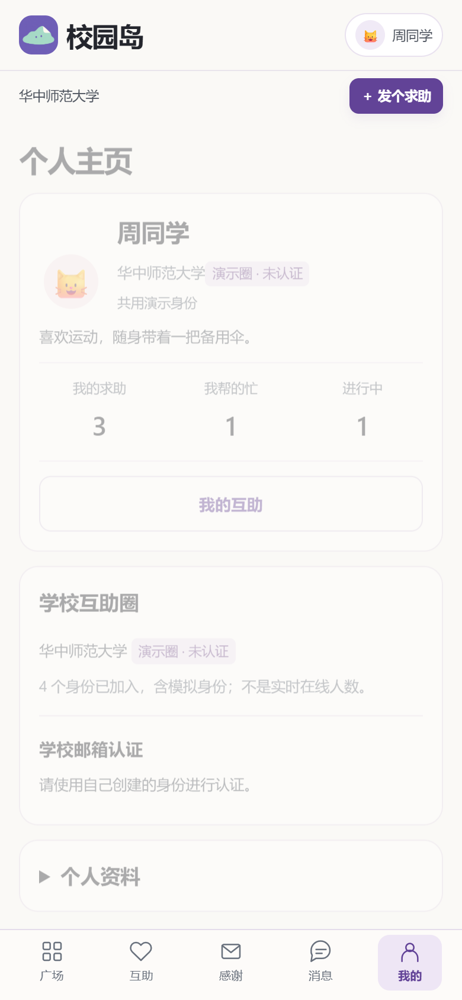
</p>

## 现在，试着完成一次互助

**[进入校园岛 →](https://xiaoyuandao73.asia)**

支持邮箱登录，也可以在账号入口进入「我的账号 → 模拟账号」，选择预设身份体验。

双人演示时，使用两个独立浏览器会话，选择同一学校的两个账号：一方发布，另一方回应，再完成沟通、交接确认与感谢。

<details>
<summary>项目范围与认证说明</summary>

当前为可运行的 MVP。预置账号、求助与截图均包含模拟数据，不代表真实使用规模。学校邮箱认证按学校逐步开放，验证邮箱控制权，不等同于在读学籍认证。当前不提供支付交易或紧急救援服务。

</details>

<details>
<summary>本地运行与技术说明</summary>

Node.js 24+，无需安装运行依赖。

```bash
 git clone https://github.com/irishale63-jpg/campus-island.git
 cd campus-island
 npm start
```

打开 `http://localhost:3000`；Windows 也可双击「启动校园岛.cmd」。

前端采用原生 HTML / CSS / JavaScript；本地 Node.js 服务与云端共用业务规则，线上使用 Cloudflare Workers、D1 数据库与 R2 图片存储。

运行 `npm test` 检查双人协作、借物归还、账号保存、邮箱验证码、学校隔离与私信权限等业务。完整流程与配置见 [产品说明](docs/product-guide.md#本地运行与实现)。

</details>
