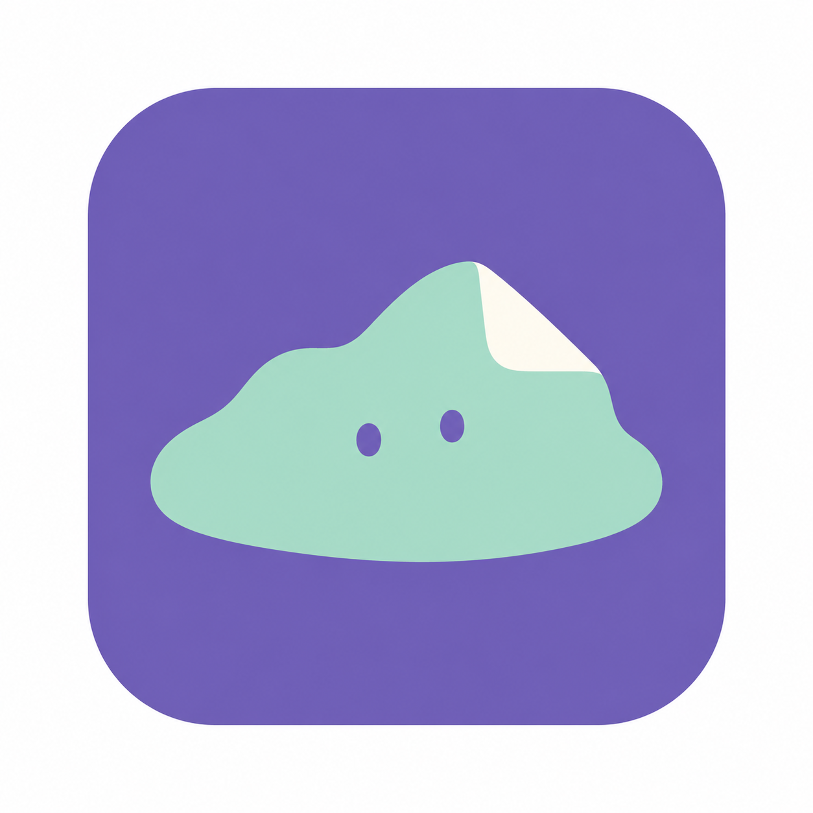
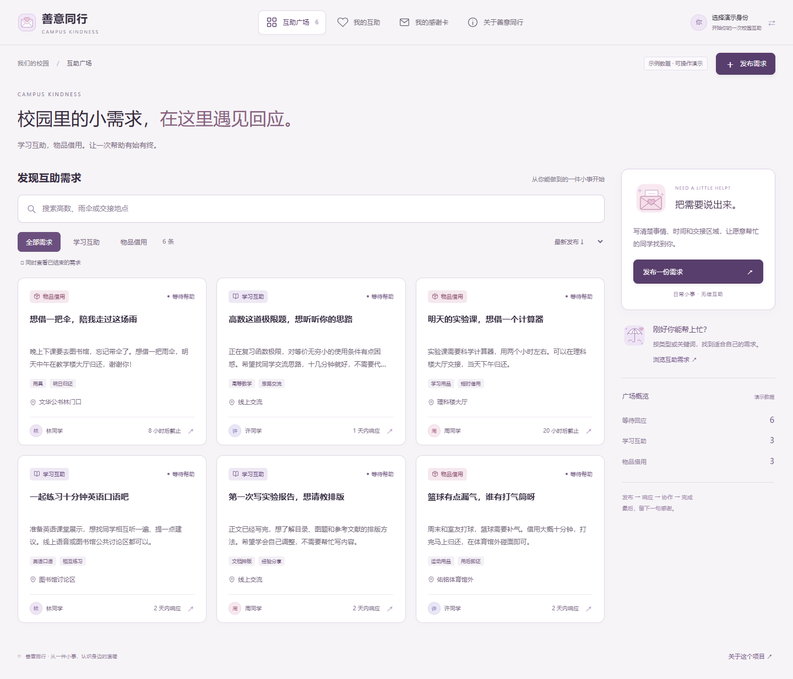
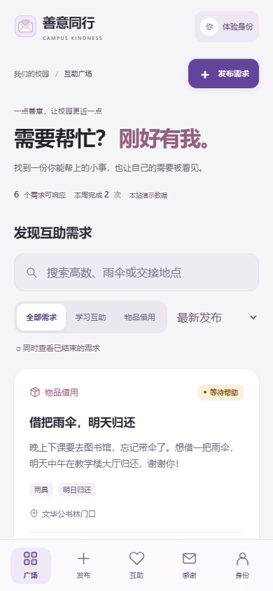
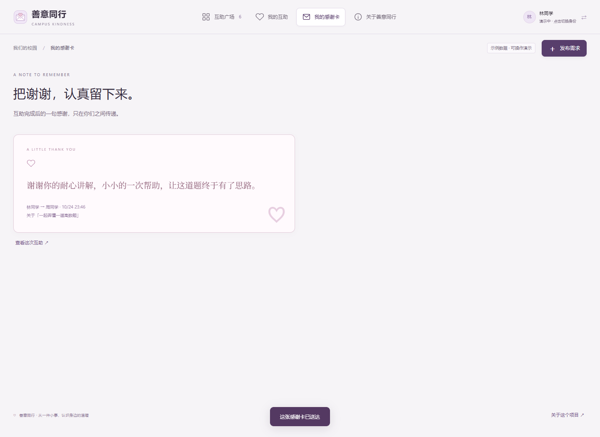
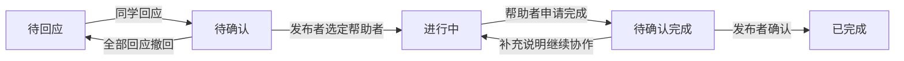
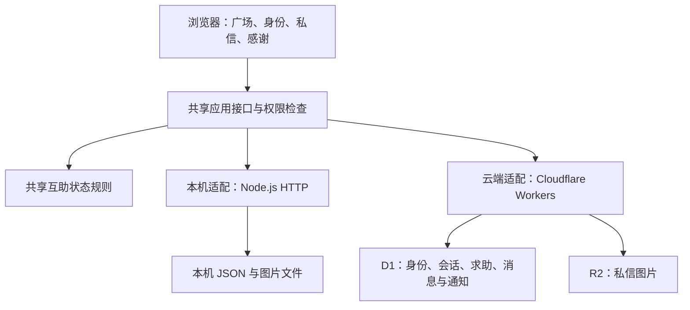

<div align="center">
  
  <h1>校园岛</h1>
  <p><strong>讲道题，借件东西，找人搭把手。</strong></p>
  <p>面向校园日常需求的轻量互助平台</p>
  <p>
    <a href="https://campus-kindness-cjq.round-bell-5229.chatgpt.site">在线体验</a> ·
    <a href="#快速开始">本地运行</a> ·
    <a href="#完整演示示例">完整示例</a> ·
    <a href="#常见问题">常见问题</a>
  </p>
</div>

---

校园岛把分散在群聊里的校园小求助集中起来，让同学找到合适的帮助者、沟通具体安排，并清楚地记录进展与结果。

当前版本聚焦 **学习交流** 和 **物品借用**：从发布求助、回应、确定帮助者，到文字与图片私信、确认完成、发送感谢，能够完成一次完整的互助。

> **评审快速体验：** 无需安装，直接打开 [在线演示](https://campus-kindness-cjq.round-bell-5229.chatgpt.site)，点击「切换身份」选择体验身份。若要完整验证两人协作，请按照下方 [完整演示示例](#完整演示示例)，分别使用普通窗口和无痕窗口。
>
> **版本说明：** 当前为比赛演示版本。七个学校圈均为演示圈，真实学校邮箱认证待配置；选择学校不代表认证通过。预设身份由访客共用，也可以创建独立身份。带「演示案例」标记的内容用于展示流程，不代表真实运营数据。



## 阅读导航

- [项目介绍](#项目介绍)：解决什么问题，适合什么场景
- [项目特点](#项目特点)：核心设计与实现方式
- [功能总览](#功能总览)：每个页面能够做什么
- [快速开始](#快速开始)：在线体验、下载、安装、启动与停止
- [手机访问与运行配置](#手机访问与运行配置)：局域网预览、端口、数据目录
- [身份与学校圈](#身份与学校圈)：快捷体验、独立身份、恢复口令
- [完整演示示例](#完整演示示例)：学习交流、物品借用、身份恢复
- [状态与业务规则](#状态与业务规则)：谁操作、什么时候可以完成或取消
- [技术架构](#技术架构)：本机与云端如何运行
- [数据保存与权限](#数据保存与权限)：数据在哪里，谁能够访问
- [测试与验证](#测试与验证)：运行测试与验证范围
- [常见问题](#常见问题)：启动、手机、身份、记录与消息问题
- [当前边界与后续方向](#当前边界与后续方向)：已完成、待配置、暂缓

## 项目介绍

### 要解决的问题

校园里的日常求助往往很小，却需要一个清楚的处理过程。例如，想请人讲一道题、临时借计算器、借一把螺丝刀：

| 遇到的问题 | 校园岛的处理方式 |
| --- | --- |
| 求助被群消息刷走，难以找到还需要帮助的人 | 广场集中展示需求，支持关键词、分类与状态筛选 |
| 有人回应后，不清楚是否已经约好 | 由发布者选定一位帮助者，再进入正式协作 |
| 题目、物品情况和见面安排散落在不同聊天里 | 私信绑定具体求助，支持文字、图片和求助摘要 |
| 借用者说已归还，但出借者还没有确认收到 | 分开记录交付、提交归还、确认收到 |
| 完成后其他人仍继续回应，经历和感谢没有留下来 | 明确关闭需求，保留进度、历史和双方感谢卡 |

### 产品范围

- **学习交流：** 讲解思路、讨论问题、练习口语、交流学习方法等。
- **物品借用：** 校园日常用品的短期借用、交付与归还。
- **协作形式：** 一对一、短周期、无偿的日常互助；学习交流支持线上或见面，物品借用采用见面交接。

同一个身份既能发布求助，也能帮助别人。当前不提供交易支付、跑腿接单或紧急救援服务。

## 项目特点

### 先确定帮助者，再开始协作

回应表达的是帮助意愿。发布者确认其中一位后，互助才进入「进行中」，双方开启对应求助的私信，其余待处理回应同步关闭，减少重复行动。

### 物品归还由双方确认

借用流程包含「出借方交付 → 借用方提交归还 → 出借方确认收到」。只有确认收到后，帮助者才能申请完成。借用者单方面点击「已归还」，不会直接把记录变成归还完成。

### 独立身份，分别保存记录

用户可以创建昵称和头像，编辑个人资料，保存自己的求助、参与、感谢与消息。新身份从空记录开始；换设备时，可使用创建时保存的恢复口令继续访问。

### 学校范围由后端校验

学校圈决定广场、搜索、详情、回应、主页和相关私信的访问范围。发布时自动取服务端保存的学校归属，直接修改请求或访问其他学校链接也会检查权限。当前提供的是分校演示圈。

### 一套业务规则，两种运行方式

本机与云端共用接口、权限和互助状态规则。本机只需 Node.js 即可运行；在线版使用持久化数据库与图片存储，方便评审直接体验。

### 让需求成为界面的重点

灰白内容底色、温柔紫色和深紫主操作建立主次。桌面显示完整列表，手机采用单列与底部导航；卡片支持整卡打开和键盘操作，空状态提供对应下一步。

## 功能总览

| 分类 | 入口或页面 | 实际支持的功能 |
| --- | --- | --- |
| 发现需求 | 互助广场 → 互助角 | 求助搜索、学习交流/借点东西分类、只看待回应、最新发布/截止时间排序、流程案例 |
| 查看需求 | 求助卡片 → 查看详情 | 完整说明、帮助时间、地点、回应截止、归还时间、状态及进度时间线 |
| 发布与编辑 | 发个求助 | 标题必填、说明选填、分类专属提示、线上/见面、公共区域提示、截止快捷选择与自定义；没有待处理回应时可编辑自己的开放求助 |
| 回应管理 | 求助详情 | 回应、补充说明、撤回；发布者选定一位帮助者 |
| 协作与完成 | 求助详情 / 私信摘要 | 申请完成、发布者确认、补充原因继续协作、取消申请与对方处理 |
| 物品归还 | 借用求助详情 | 交付、提交归还、确认收到；未确认归还不能申请完成 |
| 我的记录 | 我的互助 | 我的求助、我帮的忙、进行中、已结束 |
| 个人资料 | 个人主页 | 昵称、六个头像选项、简介、擅长什么、愿意提供的帮助、个人互助数量 |
| 身份管理 | 切换身份 | 三个快捷演示身份、自主创建、设备保存身份切换、恢复口令登录、退出 |
| 学校范围 | 个人主页 → 学校互助圈 | 七校全称/简称搜索、进入演示学校圈、清楚标识未认证状态 |
| 两人沟通 | 消息 → 对应会话 | 文字、图片、求助摘要、图片预览；互助结束后保留只读历史 |
| 进度提醒 | 消息 → 校园岛通知 | 回应、选定、撤回、取消、交付、归还、完成、感谢等有效进展提醒；未读/已读分别保存 |
| 表达感谢 | 完成详情 → 说声谢谢 / 感谢 | 完成后发送一次感谢卡，分别查看收到的和发出的，仅互助双方可见 |
| 细节体验 | 全站 | 桌面/手机布局、键盘焦点、按下反馈、操作结果、无结果/空记录/失败重试、减少动态效果支持 |

<details>
<summary><strong>查看手机界面与感谢卡截图</strong></summary>

### 手机界面



### 感谢卡



</details>

## 快速开始

### 方式一：直接在线体验

打开 **[校园岛在线演示](https://campus-kindness-cjq.round-bell-5229.chatgpt.site)**。电脑和手机均可访问，无需安装开发工具，也不需要项目电脑保持开机。

- 浏览需求：直接进入互助广场。
- 快速操作：点击「切换身份」，选择林同学、周同学或许同学。
- 独立记录：点击「切换身份 → 创建身份」，再进入学校演示圈。

预设身份由体验者共用，请只填写模拟内容。完整双人体验见 [演示示例](#完整演示示例)。

### 方式二：下载源码，在本机运行

#### 第一步：准备环境

| 环境 | 要求 | 用途 |
| --- | --- | --- |
| Node.js | **24 或以上**，从 [Node.js 官方网站](https://nodejs.org/en/download) 安装 | 提供网站服务和内置测试工具 |
| 浏览器 | 较新的 Edge、Chrome、Firefox 或 Safari，需支持 HTML dialog | 打开网页 |
| Git | 可选；使用 git clone 时需要 | 下载代码及查看历史；也可以直接下载 ZIP |

安装 Node.js 后，新开一个终端窗口，执行：

```sh
node --version
npm --version
```

能够显示版本号，且 Node.js 主版本为 24 或更高，即可继续。

**本机版本无需 npm install、无需 API Key，也不需要额外安装数据库。**

#### 第二步：获取完整项目

**使用 Git：**

```sh
git clone https://github.com/irishale63-jpg/campus-island.git
cd campus-island
```

**不用 Git：** 打开 [项目仓库](https://github.com/irishale63-jpg/campus-island)，点击 **Code → Download ZIP**，完整解压。进入能看到 `package.json`、`server.mjs` 和 `public/` 的文件夹，不能直接在压缩包里运行。

#### 第三步：启动网站

Windows 用户可以直接双击 **`启动校园岛.cmd`**。启动窗口会保留，默认浏览器自动打开网站。

也可以在项目根目录运行以下命令，Windows、macOS、Linux 均使用同一个启动命令：

```sh
npm start
```

看到类似输出即表示启动成功：

```text
校园岛已启动：http://127.0.0.1:3000
按 Ctrl+C 停止。
```

然后在浏览器打开 **<http://127.0.0.1:3000>**。

> 不要直接双击 `public/index.html`。网站需要本机服务提供身份、求助和消息接口；直接打开 HTML 文件不能完整使用。

#### 第四步：停止与重新打开

- 停止：在启动窗口按 **Ctrl+C**；双击启动方式也可关闭启动窗口。
- 重新打开：再次运行 `npm start`，或双击启动脚本。
- 默认数据会保留，重新启动不会清空求助、消息和感谢。

旧名称的「启动善意同行.cmd」「手机访问善意同行.cmd」保留为兼容入口，新用户使用校园岛版本即可。

### 开发与测试命令

| 命令 | 用途 |
| --- | --- |
| `npm start` | 启动本机网站 |
| `npm run dev` | 以 Node.js watch 模式启动，服务端文件变化后重启；页面仍需刷新 |
| `npm test` | 运行自动测试，不要求手工先启动网站 |

## 手机访问与运行配置

### 手机查看在线版

直接在手机浏览器打开在线演示地址即可。本机地址 `127.0.0.1` 仅代表当前设备，不能拿电脑的这个地址直接在手机上访问。

### 手机查看电脑上的本地版

1. 让电脑与手机连接**同一个 Wi-Fi**。
2. 如果原来的电脑启动窗口仍在运行，先停止它。
3. 双击根目录的 **`手机访问校园岛.cmd`**。
4. 在手机浏览器输入启动窗口显示的完整地址，例如 `http://192.168.1.23:3000`。这是格式示例，请使用自己窗口里的实际地址。
5. 电脑保持开机、服务保持运行；如防火墙提示，允许程序在可信的专用网络中访问。

如果当前 Wi-Fi 限制设备互访，可让电脑连接手机热点，再重新启动手机访问入口。只使用手机蜂窝网络，无法直接访问电脑的普通局域网地址。

### 可选环境变量

默认配置即可完成演示；遇到端口占用、局域网预览或需要独立数据时再调整。

| 变量 | 默认值 | 作用 |
| --- | --- | --- |
| `PORT` | `3000` | 服务端口 |
| `LAN` | 未设置 | 设为 `1` 时选取局域网地址监听，供同一网络的手机访问 |
| `DATA_FILE` | `data/store.json` | 指定另一份本机数据文件；不必删除原数据即可开始独立演示 |
| `DEMO_MODE` | 开启 | 设为字符串 `false` 时关闭预设身份入口；不会启用真实学校认证 |

配置通过系统环境变量读取，项目不会自动读取 `.env` 文件。

<details>
<summary><strong>查看端口、局域网和独立数据的配置示例</strong></summary>

**Windows PowerShell：端口改为 3001**

```powershell
$env:PORT = "3001"
npm start
```

打开 `http://127.0.0.1:3001`。停止后，如需在当前终端恢复默认端口：

```powershell
Remove-Item Env:PORT
```

**Windows PowerShell：同一 Wi-Fi 访问**

```powershell
$env:LAN = "1"
npm start
```

**Windows PowerShell：使用独立演示数据**

```powershell
$env:DATA_FILE = "./data/review/store.json"
npm start
```

只有指定的数据文件不存在时才会创建初始数据；现有默认数据不受影响。自定义数据目录由使用者管理，不要把其中的会话或个人记录上传到仓库。

**macOS / Linux：**

```sh
PORT=3001 npm start
```

```sh
LAN=1 npm start
```

```sh
DATA_FILE=./data/review/store.json npm start
```

</details>

## 身份与学校圈

### 两种身份使用方式

| 方式 | 适用场景 | 记录归属 | 登录方式 |
| --- | --- | --- | --- |
| 快捷演示身份 | 快速了解功能、演示现有案例 | 由选择同一身份的访客共用 | 切换身份，选择林同学、周同学或许同学 |
| 自建独立身份 | 从空记录体验完整流程、持续保存自己的操作 | 分别保存自己的资料、求助、参与、感谢与消息 | 创建后保留设备会话；跨设备用恢复口令恢复 |

预设身份固定在华中师范大学演示圈，个人资料只读。访客默认浏览该演示圈。

### 创建自己的身份

1. 点击「切换身份 → 创建身份」。
2. 填写昵称、选择头像，点击「创建身份」。
3. **保存只展示一次的恢复口令**，然后点击「已保存，进入主页」。
4. 在个人主页填写简介、擅长什么和愿意提供的帮助，点击「保存」。
5. 搜索学校，选中结果，再点击「进入演示学校圈」。
6. 返回广场，即可浏览当前学校演示圈的需求，或发布自己的求助。

自建身份尚未加入学校圈时，不能浏览学校圈或发布、回应求助。新身份不会继承预设用户的经历。

### 首批七所学校

| 学校全称 | 搜索示例 |
| --- | --- |
| 武汉大学 | 武大、WHU |
| 华中科技大学 | 华科、HUST |
| 中国地质大学（武汉） | 地大、CUG |
| 武汉理工大学 | 武汉理工、WHUT |
| 华中农业大学 | 华农、HZAU |
| 华中师范大学 | 华师、CCNU |
| 中南财经政法大学 | 中南财大、ZUEL |

学校搜索与广场的求助搜索相互独立。双方必须位于**同一个学校演示圈**才能找到彼此的求助并协作。

目前学校邮箱认证显示「待配置」，未核验真实在读身份。学校归属不能通过修改普通资料更换，换校及旧记录处理流程尚未开放。

## 完整演示示例

### 演示前准备

**同时打开普通浏览器窗口 A 和无痕窗口 B，或使用两个不同浏览器。** 普通浏览器的两个标签页会共享登录身份，无法分别代表两个人。

以下示例用 A 作为求助者、B 作为帮助者：A 选择「林同学」，B 选择「周同学」。两者已经处于同一个演示学校圈，可以直接开始。

如果改用自建身份，请先分别创建，并加入同一个学校演示圈。公开演示使用模拟内容即可。

### 示例一：学习交流，从发布到感谢

#### 发布内容

在窗口 A 点击「发个求助」，可按下面填写：

| 字段 | 示例 |
| --- | --- |
| 分类 | 学习交流 |
| 需要什么帮助？ | 想请人讲一道 C++ 题 |
| 补充说明（选填） | 二分查找的边界条件总是弄混，希望一起讨论思路，不需要代写。 |
| 所需时间（选填） | 今天方便时，约 15 分钟 |
| 协作方式 | 线上 |
| 回应截止时间 | 点击「2 小时后」 |

说明也可以留空；线上方式不需要填写见面地点。

#### 双人完整操作

| 步骤 | 谁操作 | 具体操作 | 应看到的结果 |
| --- | --- | --- | --- |
| 1 | A 求助者 | 填好表单，点击「发布」 | 详情显示「已发布」，自己的记录中出现求助 |
| 2 | B 帮助者 | 在广场搜索完整标题，打开求助 | 看到说明、帮助时间、回应截止等完整信息 |
| 3 | B | 可补充一句方便时间，点击「我能帮」 | 显示「已回应」，等待发布者确定 |
| 4 | A | 打开「消息 → 校园岛通知」中的提醒，或刷新求助详情；点击 B 对应的「确定帮忙」并确认 | 求助进入「进行中」，双方出现私信入口 |
| 5 | 任一方 | 在详情点击「发私信」，或进入消息中的对应会话 | 会话显示对方、关联求助摘要与聊天记录 |
| 6 | A、B | 发送文字；点击「图片」选择不超过 3 MB 的 PNG/JPEG/WebP 后发送 | 对方能阅读文字、看到图片并点击放大；未读状态随阅读更新 |
| 7 | B | 点击聊天中的求助摘要回到详情，点击「申请完成」 | 状态变为「待确认完成」，A 收到提醒 |
| 8 | A | 查看结果，点击「确认完成」并确认 | 显示「这件事已解决」，双方记录更新，会话保留只读历史 |
| 9 | A | 点击「说声谢谢」，填写“谢谢你帮我理清边界条件，现在弄明白了。”，点击「发送」 | 感谢卡保存在该次互助中 |
| 10 | A、B | A 打开「感谢 → 发出的」，B 打开「感谢 → 收到的」 | 双方分别看到同一张感谢卡，B 收到感谢通知 |

如果 A 认为还有问题，可以在「待确认完成」阶段填写补充原因并点击「继续协作」，任务会回到进行中，B 之后可再次申请完成。

**演示结果：** 一次求助的发布、回应、选择、沟通、完成确认和感谢全部留下记录。其他未参与身份无法查看双方的私信、图片或私有感谢内容。

### 示例二：借一把螺丝刀，双方确认归还

A 作为借用者，B 作为出借者。

#### 发布内容

| 字段 | 示例 |
| --- | --- |
| 分类 | 借点东西 |
| 需要什么帮助？ | 想借一把螺丝刀 |
| 补充说明（选填） | 用于拧紧小台灯底座，借用约半小时，会按约定归还。 |
| 所需时间（选填） | 今天方便时，约半小时 |
| 协作方式 | 见面，借用类自动选定 |
| 见面地点 | 图书馆一楼公共大厅 |
| 回应截止时间 | 2 小时后 |
| 归还时间 | 选择回应截止之后的时间，例如明天 18:00 |

#### 交付与归还

| 步骤 | 谁操作 | 具体操作 | 记录变化 |
| --- | --- | --- | --- |
| 1 | A 借用者 | 发布借用求助 | 求助等待回应 |
| 2 | B 出借者 | 找到求助并点击「我能帮」 | 等待 A 确定 |
| 3 | A | 点击「确定帮忙」 | 双方进入进行中，可用私信约定交接 |
| 4 | B | 实际交付物品后，在详情点击「已交付」并确认 | 记录交付，A 收到提醒 |
| 5 | A | 实际归还物品后，点击「已归还」并确认 | 仅记录“提交归还”；B 收到“对方已提交归还，请确认收到”的提醒 |
| 6 | B | 实际收到物品后点击「确认收到」 | 归还得到双方确认，A 收到提醒 |
| 7 | B | 点击「申请完成」 | 等待 A 最终确认 |
| 8 | A | 点击「确认完成」，再选择「说声谢谢」 | 互助结束，感谢与历史保留 |

**关键区别：** 第 5 步还不能代表 B 已收到物品；第 6 步完成后，才允许申请结束。物品已交付的借用任务，也不能绕过归还确认直接协商取消。

### 示例三：创建、退出与恢复独立身份

1. 创建一个新的独立身份，保存恢复口令，并加入某个学校演示圈。
2. 发布一条求助，在「我的互助 → 我的求助」确认出现自己的记录。
3. 点击「切换身份 → 退出当前设备」，按提示确认退出。
4. 点击「切换身份 → 恢复身份」，输入之前保存的恢复口令。
5. 进入主页和我的互助，确认昵称、学校与求助仍然存在。
6. 如该身份已有协作、消息和感谢，恢复后也可继续查看授权记录。

独立身份的设备会话最长保留 30 天。恢复口令相当于该演示账号的登录凭据；后端保存其哈希，创建后不会再次展示原文，丢失时暂不支持找回。

## 状态与业务规则

### 需求状态流转



| 规则 | 具体行为 |
| --- | --- |
| 回应与选择 | 不能回应自己的需求；同一身份不能重复提交待处理回应；最终只确定一位帮助者 |
| 求助编辑 | 发布者可编辑尚处于待回应、且没有待处理回应的求助；进入协作后不能随意改写原需求 |
| 回应截止 | 只关闭尚未选定帮助者的开放求助；进行中的任务不会因原回应截止到期而自动完成 |
| 三种时间 | 回应截止决定何时停止接收新回应；所需时间是实际帮助安排；归还时间是借用约定，必须晚于回应截止 |
| 未开始的取消 | 发布者可直接取消开放求助，待处理回应同步关闭 |
| 协作中的取消 | 一方申请，另一方同意或选择继续；借用物品已交付时需先确认归还 |
| 完成与感谢 | 帮助者先申请完成，发布者再确认；完成后发布者可发送一次感谢 |
| 结束后私信 | 已完成或已取消的会话保留历史，停止发送新消息 |

## 技术架构

前端采用 HTML、CSS 和原生 JavaScript。后端把接口权限和互助状态规则集中在共享模块中，再分别接入本机文件存储与云端服务。



| 层次 | 实现 |
| --- | --- |
| 页面与交互 | HTML / CSS / 原生 JavaScript，原生 dialog、响应布局、无外部字体依赖 |
| 本机服务 | Node.js 24+ 内置 HTTP、文件、加密与测试模块 |
| 共享业务 | application.mjs 统一接口与访问检查；domain.mjs 处理回应、借用、完成等状态变化 |
| 身份与范围 | identity.mjs 管理恢复口令哈希、学校白名单、身份资料与兼容升级 |
| 云端持久化 | Cloudflare D1 保存数据与会话；带 revision 的条件更新和重试减少并发覆盖 |
| 图片存储 | 本机私有文件目录 / 云端 R2，通过应用接口鉴权读取 |
| 在线托管 | Cloudflare Workers，由 Sites 构建与发布；详细配置见部署说明 |

### 目录结构

```text
campus-island/
├─ public/
│  ├─ index.html           页面入口与对话框
│  ├─ styles.css           视觉与响应布局
│  ├─ app.js               广场、发布、详情、互助与感谢交互
│  ├─ account.js           身份、主页与学校选择
│  ├─ messages.js          会话、图片、通知与未读交互
│  └─ brand-island.png     小岛纸角品牌图标
├─ lib/
│  ├─ application.mjs      共享接口、权限及消息处理
│  ├─ domain.mjs           互助状态规则
│  ├─ identity.mjs         身份、恢复口令与七校范围
│  ├─ cloud-api.mjs        D1 / R2 云端适配
│  ├─ seed.mjs             演示数据与案例兼容
│  └─ local-address.mjs    本机/局域网地址选择
├─ server.mjs              本机服务入口
├─ scripts/                双击启动与云端同步脚本
├─ tests/                  流程、权限、存储与并发测试
├─ docs/                   截图、实施记录与提交说明
├─ deploy/                 云端表结构与部署说明
├─ package.json            运行命令及 Node.js 版本要求
├─ 启动校园岛.cmd          Windows 本机入口
└─ 手机访问校园岛.cmd      Windows 局域网入口
```

`data/` 为运行后生成的数据目录，不在源码仓库中。早期策划和修改记录保留用于说明项目演进，当前实际功能与运行方式以本 README 为准。

## 数据保存与权限

### 数据在哪里

| 数据 | 本机运行 | 在线版本 |
| --- | --- | --- |
| 身份、会话、求助、回应、文字消息、通知、阅读状态、感谢 | 默认 data/store.json | D1 数据库 |
| 私信图片 | 默认 data/uploads/ | 私有 R2 存储，通过应用接口访问 |

本机与在线版数据相互独立。本机重启保留默认数据；云端代码发布采用增量兼容，不清空已有互助记录。首次启动仅在缺少数据时创建初始记录，示例案例按标识补入，避免重复插入。

### 谁能看到什么

- **公开求助：** 在用户当前有权访问的学校圈内显示；跨校直接访问详情或参与接口也会校验范围。
- **回应内容：** 发布者可查看自己的求助收到的回应，回应者可查看自己的回应。
- **私信与图片：** 仅确定的互助双方可访问，其他身份不能凭图片链接读取内容。
- **感谢卡：** 默认仅该次互助双方可见，分别出现在收到的与发出的列表。
- **共用演示身份：** 所有选中相同预设身份的体验者都在使用同一账号，能够访问这个账号的授权记录。独立身份通过会话和恢复口令访问自己的记录。

私信图片单次一张，支持 PNG / JPEG / WebP，最多 3 MB；后端校验大小和文件特征，不接受任意附件。文字消息最多 500 字符，单会话当前上限 300 条消息。

如需备份本机数据，先停止服务，再一起复制数据文件及同级 uploads/ 图片目录。数据文件包含会话等私有信息，不要上传到公开仓库；默认数据、凭据和缓存已通过 .gitignore 排除。

## 测试与验证

在项目根目录执行：

```sh
npm test
```

测试自动创建独立临时数据和测试服务，不会修改默认演示数据，也不需要手工先启动 3000 端口。

| 测试文件 | 数量 | 主要验证内容 |
| --- | --- | --- |
| tests/workflow.test.mjs | 6 | 学习闭环、借用归还、并发选人、撤回与取消、截止、请求验证与访问边界 |
| tests/cloud.test.mjs | 3 | 真实 SQLite 上的云端 SQL、会话、私有视图、并发重试、升级保留数据 |
| tests/demo.test.mjs | 1 | 示例仅增量补入一次，保留已有需求与对话 |
| tests/island.test.mjs | 5 | 独立身份恢复、七校隔离、编辑与通知、私信图片权限、已读持久化与归还提醒 |
| **合计** | **15** | 覆盖主要流程、权限与持久化 |

已在 Windows / Node.js 24 环境运行上述测试，并使用 Edge 自动化验证双人完整流程、图片预览、身份恢复、跨标签身份切换、键盘和空状态。检查的页面宽度包括 360、390、640、768、1024、1440 像素；手机视口检查不等同于完整的 iPhone / Android 真机验证。

原生 Worker 本地预览另验证了 D1 与 R2 绑定下的身份、私信、图片、权限和阅读状态。以上验证范围不代表正式生产安全审计或大规模压力测试。

## 常见问题

| 问题 | 处理方式 |
| --- | --- |
| 提示找不到 node 或 npm | 安装 Node.js 24+ 后，新开终端再执行 node --version；双击入口也会尝试使用 Windows 默认安装路径中的 Node |
| 提示找不到 package.json | 进入解压后的真正项目根目录，确认当前文件夹能看到 package.json；不要在压缩包或外层目录里启动 |
| 提示端口已占用 / EADDRINUSE | 停止之前的启动窗口再运行；或按配置示例将 PORT 改为 3001，并使用对应地址 |
| 浏览器没有自动打开 | 手动访问启动窗口显示的地址；npm start 本身只启动服务，Windows 双击入口才会尝试自动打开浏览器 |
| 手机打不开本地页面 | 使用手机访问入口，确认同一 Wi-Fi、实际局域网地址、端口、服务运行状态及专用网络防火墙权限；手机不要输入电脑的 127.0.0.1 |
| 两个窗口总是同一个身份 | 普通标签页共享登录会话，改用一个普通窗口和一个无痕窗口，或两个不同浏览器 |
| 自建身份的广场为空 | 先在个人主页进入学校演示圈；新学校圈可能没有现成需求，可由另一同校身份发布测试求助 |
| 进行中的求助在首页“消失” | 首页默认只看待回应；取消勾选该筛选，或进入“我的互助 → 进行中”查看 |
| 看不到对方的求助 | 检查双方是否在同一站点、同一学校演示圈；本机与在线版数据独立，也不要把正文搜索当作学校搜索 |
| 无法申请完成或确认完成 | 帮助者先申请，发布者再确认；借用任务还必须先交付、提交归还、确认收到，并处理待确认的取消申请 |
| 私信没有立刻显示 | 网站可见期间每 15 秒检查消息，也可刷新；关闭网站后没有系统推送，离线内容会保存 |
| 恢复口令丢失 | 当前没有找回流程；仍有有效会话时可以继续使用，退出或会话失效后可能无法恢复该身份 |
| 已有学校为什么还显示未认证 | 目前加入的是演示学校圈，真实学校邮箱验证待配置，不能作为在读身份证明 |

## 当前边界与后续方向

| 状态 | 内容 |
| --- | --- |
| 已完成 | 日常互助闭环、独立身份、个人主页、七校演示圈、文字图片私信、进度通知、未读留存、归还双方确认、感谢与本机/在线运行 |
| 待配置 | 真实学校邮箱发信服务、各校域名核对及验证码流程 |
| 待确定 | 无学校邮箱时的替代认证、严格在读身份核验、换校与旧记录处理 |
| 暂缓 | 深色模式、分享预览、首次引导、语音视频、站外系统推送 |
| 正式运营前需补齐 | 账号找回、审核管理、自动备份体系、更大规模存储与负载验证 |

云端当前为比赛规模：状态快照上限约 1.8 MB，每 IP 五分钟最多 120 次写入，超限会返回明确提示；不承诺无限容量。独立域名验证完成前，README 使用上方已可访问的演示地址。

## 项目资料与参考

- **源码仓库：** [irishale63-jpg/campus-island](https://github.com/irishale63-jpg/campus-island)
- **在线体验：** [打开校园岛](https://campus-kindness-cjq.round-bell-5229.chatgpt.site)
- **云端说明：** [部署与数据迁移](deploy/README.md)。托管工程由独立源码仓库管理，本仓库包含本机可运行源码和共享云端业务模块；本机运行不依赖托管工程。
- **实施范围：** [本轮实施对照](docs/校园岛_实施对照.md)
- **提交与演示：** [比赛提交说明](docs/提交说明.md)

设计方法参考 [Emil Kowalski](https://github.com/emilkowalski/skills) 的相关设计指南，侧重信息层级、克制的动效和移动端操作。品牌使用“小岛纸角”图标。项目目前尚未选定开源许可证。
