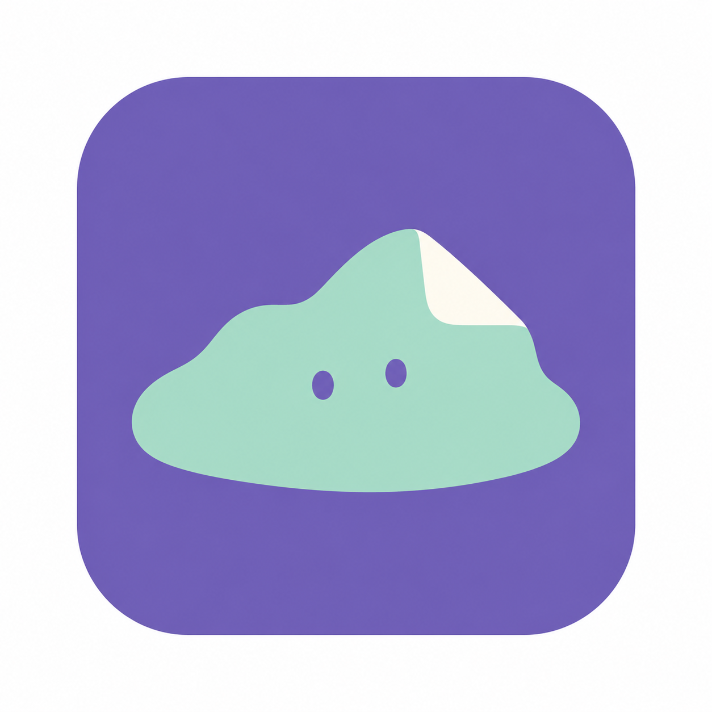
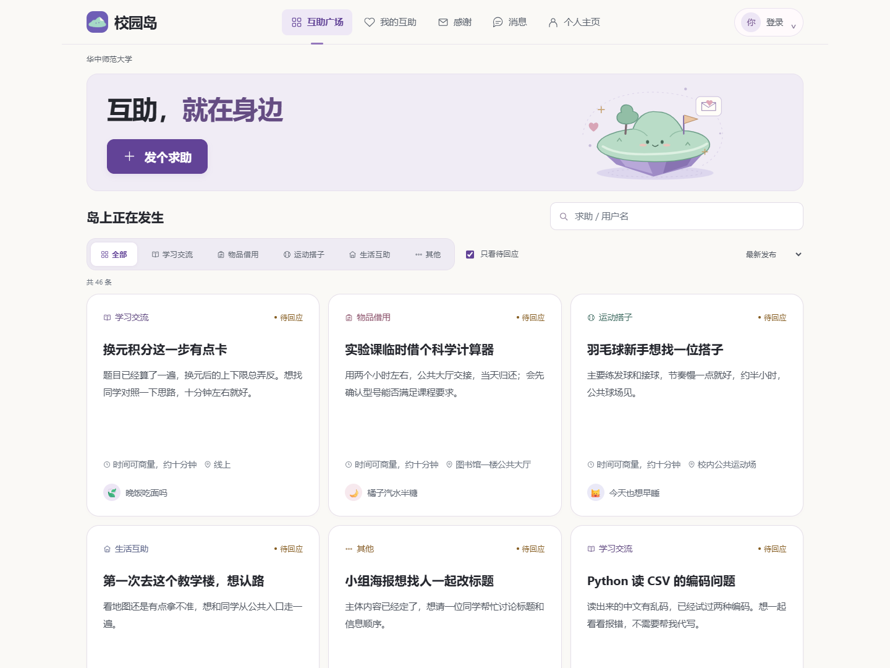
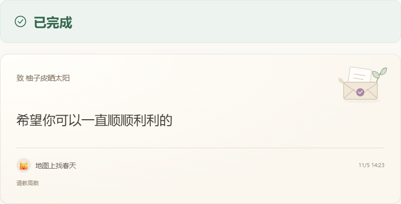
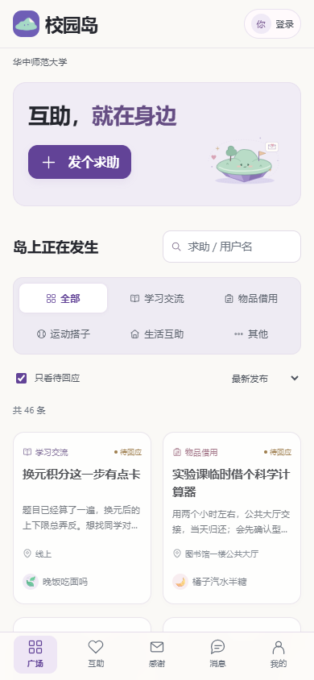

<div align="center">
  
  <h1>校园岛</h1>
  <p><strong>互助，就在身边。</strong></p>
  <p>让校园里的小求助，有人回应，也有结果。</p>
  <p><a href="https://xiaoyuandao73.asia">进入校园岛 →</a></p>
</div>

## 校园里的小事，为什么还需要一个平台？

实验前临时借一个计算器，想请同学讲清一道题，或者找个人一起练半小时羽毛球。这些需求并不复杂，校园里也可能有人愿意帮忙，但双方常常没有遇见。

我们习惯把求助发进群聊。消息被刷走后，想帮忙的人未必看见；几个人同时回应，又要逐一解释、确认安排。约好之后，题目图片、时间和地点散落在聊天里；借出去的物品是否归还、一次帮忙是否完成，也缺少清楚的收尾。

**校园岛从这些具体的小事出发，把“说出需要”到“完成帮助”的过程接起来。** 同校同学可以发现彼此的需求，确定谁来帮忙，在站内沟通，并共同确认结果。完成之后，再把一句谢谢认真留下来。



## 我们希望解决的，是一次互助里的这些问题

| 日常求助中的困扰 | 校园岛的设计 |
| --- | --- |
| 求助很快被群消息淹没，不知道谁还需要帮助 | 按学校集中展示，结合分类、搜索、状态与截止时间寻找需求 |
| 有人说“我可以”，但不清楚最后由谁来帮 | 发布者从回应中选定一位帮助者，双方再进入正式协作 |
| 具体安排需要反复解释，进展难以跟上 | 求助详情集中呈现说明、时间和地点，私信与通知关联这次互助 |
| 一方说完成了，另一方还没有确认；借物归还容易含糊 | 完成申请由另一方确认，借物另设交付与归还确认流程 |
| 事情结束就散了，付出的善意没有留下反馈 | 保存互助记录，完成后可以给对方写一张感谢卡 |

## 一次互助，怎样在校园岛发生？

**发布求助 → 同学回应 → 选定帮助者 → 私信协作 → 确认完成 → 留下感谢**

同一个账号既可以求助，也可以帮助别人。当前聚焦同校、一对一、日常无偿互助：讲一道题、借一件东西、找一个搭子，或请人搭把手。

### 01 · 找到自己能帮上的小事

互助广场按学校圈展示需求，分为 **学习交流、物品借用、运动搭子、生活互助、其他** 五类。没有合适分类的求助，也能通过「其他」被发布和找到。

可以搜索求助内容或用户名，只看仍在等待回应的需求，按最新发布或截止时间排序。卡片先展示标题、说明、地点和发布者，点开后再看完整信息。电脑每页 6 张、手机每页 4 张，减少一次面对过多内容的负担。

学校圈贯穿广场、搜索、回应和会话权限，让一次线下见面或物品交接有明确的校园范围。

### 02 · 把需要说清楚，把安排放在一起

发布时写明需要什么帮助，再补充说明、时间和协作方式；线下见面填写地点，借用物品增加归还时间。截止时间支持快捷选择，也可以自行设置。

发布表单与求助详情采用统一的信息分组：**说明、方式、时间、地点和截止** 集中呈现，方便双方快速判断是否合适。标题承担主要表达，补充说明按需填写；在尚无待处理回应时，也可以修改自己的开放求助。

### 03 · 先回应，再确定谁来帮

愿意帮忙的同学可以留下一段回应，说明自己能提供什么帮助；安排变化时，也可以撤回。

发布者从回应中选定一位帮助者后，求助进入「进行中」，其余待处理回应同步关闭，双方开启对应会话。这样，多人表达意愿之后，真正负责这次协作的人仍然清楚，也减少重复到场和来回确认。

### 04 · 围绕这件事，把话说完

选定帮助者后，双方可以在站内发送文字和图片：讨论一道题的步骤、确认见面安排，或说明借用物品的情况。会话列表保留关联求助，进度通知提醒回应、选定、归还和完成等变化。

聊天页以对方名字、头像和气泡为主，支持图片放大、未读提醒与新消息入场动效。互助结束后，对话作为只读历史保留，方便回看当时的约定。

### 05 · 完成，要有双方认可的结果

普通互助由帮助者提交完成申请，再由求助者确认；如果还需要继续，可以说明原因后回到协作中。进行中的取消也需要另一方处理，避免协作在对方不知情时突然结束。

**物品借用有更完整的归还流程：**

> 出借方确认交付 → 借用方提交归还 → 出借方确认收到 → 申请完成 → 求助者确认完成

例如，临时借计算器时，双方先约定公共区域交接和归还时间；借用者提交“已归还”后，还需要出借者确认收到，才能继续完成流程。归还是否结束，由双方共同确认。

开放求助到达截止时间后会停止接收回应；已经开始的协作不会仅因截止时间到了就被自动算作完成。

### 06 · 把结果记下来，把谢谢送给对方

「我的互助」分别整理自己发起的求助、参与的帮助、进行中和已结束的记录；详情中可以展开查看进度，不必翻找群聊来回忆事情走到了哪一步。

完成后，页面用清楚的 **「已完成」** 呈现结果。求助者还可以给帮助者写一张感谢卡，在「感谢」中分别查看收到与发出的心意，仅互助双方可见。

我们希望帮助不只停在一个状态按钮上。一句具体的感谢，能够让对方知道这次付出被认真接收，也让校园里的小善意留下自己的痕迹。



## 清楚、轻盈，也有一点温度

校园岛用统一的信息层次承载完整流程：需求先被看见，重要操作容易找到，进度与结果有明确反馈。

- **适合电脑，也适合手机**：桌面卡片与手机双列布局、底部导航，保持熟悉的操作顺序。
- **把复杂信息整理好**：发布和详情采用账本式分组，聊天页专注对话，长说明和历史记录按需展开。
- **让善意有自己的视觉表达**：紫色与小岛形象、轻微浮动的小岛、暖白纸笺感谢卡与信封枝叶插画。
- **照顾不同使用习惯**：深浅色模式、清晰的文字层级和操作反馈；新增消息动效尊重系统的减少动态效果设置。

<details>
<summary>查看手机界面</summary>
<br>

</details>

## 支撑长期使用的基础能力

| 能力 | 当前支持 |
| --- | --- |
| 个人账号 | 邮箱验证码登录，首次验证创建账号；账号切换、唯一用户名、自定义头像与个人资料 |
| 学校圈 | 1412 所本科高校目录，学校搜索每页最多 6 所；支持退出并重选，原校记录保留 |
| 学校邮箱认证 | 按官方后缀逐校开放，目前核实开放 31 所；验证邮箱控制权，不等同于在读学籍 |
| 数据保存 | 账号、求助、消息、头像与感谢持久保存，重新登录后可以继续使用 |
| 管理后台 | 独立授权，查看账号、求助、各校人数和数据来源，支持概览导出 |

## 体验一次完整互助

打开 **[校园岛](https://xiaoyuandao73.asia)**，用自己的邮箱登录；也可以从账号入口进入「我的账号 → 模拟账号」，选择一个名字体验流程。

双人体验时，使用两个独立浏览器会话，选择**同一学校**的两个账号：一方发布，另一方回应，再完成选人、沟通、确认与感谢。

当前是可运行的 MVP。预置账号和求助是模拟样本，不代表真实使用规模；学校邮箱认证仍在逐校扩展，访问稳定性和更大规模的数据承载也在完善中。当前不提供支付交易或紧急救援服务。

## 本地运行与实现

Node.js 24+，无需安装运行依赖。

```bash
git clone https://github.com/irishale63-jpg/campus-island.git
cd campus-island
npm start
```

打开 `http://localhost:3000`；Windows 也可双击「启动校园岛.cmd」。

前端使用原生 HTML / CSS / JavaScript，本机 Node.js 服务与云端共用业务规则；线上采用 Cloudflare Workers、D1 数据库与 R2 图片存储。消息通过轮询更新，云端状态快照有明确容量上限。

`npm test`：**35 项测试通过**，覆盖双人协作、借物归还、并发选人、账号持久化、邮箱验证码、学校隔离与私信权限。

<details>
<summary>运行配置</summary>

- 本地数据保存在 `data/`，与线上数据相互独立。
- 邮件需配置 `RESEND_API_KEY`、`VERIFICATION_FROM`、`VERIFICATION_SECRET`；学校后缀由后台配置，未配置时不会发送验证码。
- `/admin` 使用独立管理口令。本地首次启动在 `data/admin-key.txt` 生成；线上通过 `ADMIN_KEY` 配置。

</details>
